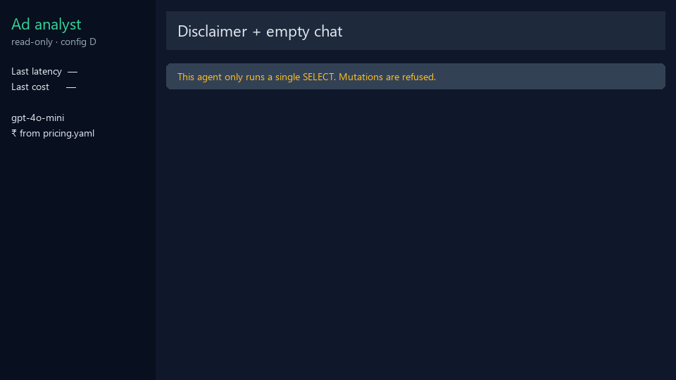
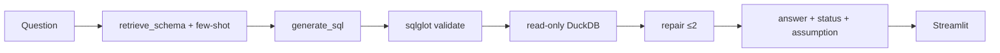

# Agentic text-to-SQL ad analyst

LangGraph agent that answers warehouse questions in English, with a 50-question eval harness and a read-only Streamlit UI.

Warehouse and attribution tables come from the sister project: [Multi-Touch-Attribution-Budget-Reallocation](https://github.com/Aviralspamscode/Multi-Touch-Attribution-Budget-Reallocation).

## Headlines (from `RESULTS.md` / `eval/results/summary.md`)

1. **Config D (GPT-4o-mini) is the primary model:** execution accuracy **42.0% → 52.0%** vs schema-only, on 50 signed-off questions × 3 runs.
2. **Median 3.0 s and ₹0.046 per query** (official mini prices, USDINR 96.33).
3. **GPT-4o comparison (config F):** 61.3% accuracy at ₹1.17/query — about +9 pp for ~25× the rupee cost.



## Architecture



Default graph is **config D** (calibrated refusal rules + few-shot). E/F add a plan node and metric views (`sql/10_metric_views.sql`).

## Reproduce

Build `warehouse.duckdb` with the sister repo (or copy that file here), then:

```bash
uv sync
cp .env.example .env          # LLM_PROVIDER=openai  LLM_MODEL=gpt-4o-mini  API_KEY=...
uv run python -c "import duckdb; duckdb.connect('warehouse.duckdb').execute(open('sql/10_metric_views.sql').read())"
uv run streamlit run app/streamlit_app.py
uv run pytest
```

Logged eval (do not re-run unless you have signed off gold SQL): `eval/results/eval.jsonl` and `eval/results/summary.md`. Re-score only: `uv run python -m eval.rescore`.

## Layout

- `agent/` — LangGraph, prompts, semantic layer, few-shot pool
- `eval/` — 50-q gold set, 15-q dev set, harness, logs
- `app/streamlit_app.py` — chat UI (status, assumption, SQL expander, ₹/latency)
- `sql/10_metric_views.sql` — default CPA, credit rate, linear/last, view vs click spend

## Assumptions

- Agent is read-only. Mutations return `REFUSE`.
- Tuning of D/E/F used `eval/dev_questions.yaml` only.
- Few-shot leakage check: max Jaccard vs eval is 0.444 (flag at 0.85).
- Cost is scaled in the warehouse; ₹ in the sidebar is **LLM token cost**, not media spend.
