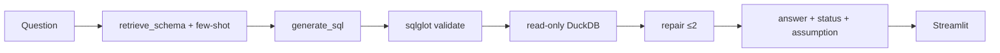

# Agentic text-to-SQL ad analyst

LangGraph agent that answers warehouse questions in English, with a 50-question eval harness and a read-only Streamlit UI.

Warehouse and attribution tables come from the sister project: [Multi-Touch-Attribution-Budget-Reallocation](https://github.com/Aviralspamscode/Multi-Touch-Attribution-Budget-Reallocation).

## Headlines (from `RESULTS.md` / `eval/results/summary.md`)

1. **Config D (GPT-4o-mini) is the primary model:** execution accuracy **42.0% → 52.0%** vs schema-only, on 50 signed-off questions × 3 runs.
2. **Median 3.0 s and ₹0.046 per query** (official mini prices, USDINR 96.33).
3. **GPT-4o comparison (config F):** 61.3% accuracy at ₹1.17/query — about +9 pp for ~25× the rupee cost.


## Architecture



Default graph is **config D** (calibrated refusal rules + few-shot). E/F add a plan node and metric views (`sql/10_metric_views.sql`).

## Configs A–F

Same 50 questions, same DuckDB warehouse, GPT-4o-mini unless noted. Each config adds one layer.

| Config | What the model sees | Result (3 runs, after grader audit) |
| --- | --- | --- |
| **A** | Table names and column types only | 42.0% |
| **B** | A + semantic layer (grain, metric definitions, pitfalls) | 39.3% |
| **C** | B + 3 nearest few-shot question→SQL pairs | 49.3% |
| **D** | C + calibrated rules (refuse writes only; defaults beat ambiguity). **Resume primary.** | **52.0%**, ₹0.046/query |
| **E** | D + default metric views (`v_*`) + a plan node before SQL | 39.3% (views joined onto subset questions) |
| **F** | E’s graph with **GPT-4o** | 61.3%, ₹1.17/query |

## How gold is scored (not cosine)

The harness does **not** embed the question or the SQL. Gold is **executed SQL**. Predicted query and gold query both run on DuckDB; [`eval/compare.py`](eval/compare.py) compares the **result tables**:

- Same row count. Extra predicted columns are allowed; missing gold columns fail.
- Column **names** need not match (permutations of pred columns vs gold).
- Numbers: relative tolerance **1e-6**, or share vs percent (0.36 ≡ 36).
- Labels compared as strings. Order only if the question uses most / least / cheapest / top / …
- **`key_columns`:** a “which segment” item is graded on `unit` only.
- Adversarial items pass on **status** (`REFUSED`, `NOT_IN_DATA`, …), not on a table. `ANSWERED` on “which is best?” needs a named **assumption**.

Token **Jaccard** is only for few-shot leakage (eval question vs teaching pool; max 0.444). It is not the accuracy metric.

## Run the UI and backend

There is no separate API process. **Streamlit is the UI**; each question runs the LangGraph agent (retrieve → SQL → sqlglot → read-only DuckDB → repair → answer) inside that same process. Default graph is config D.

```bash
uv sync
cp .env.example .env          # LLM_PROVIDER=openai  LLM_MODEL=gpt-4o-mini  API_KEY=...
# warehouse.duckdb from the sister repo, then:
uv run python -c "import duckdb; duckdb.connect('warehouse.duckdb').execute(open('sql/10_metric_views.sql').read())"
uv run streamlit run app/streamlit_app.py
```

Opens at [http://localhost:8501](http://localhost:8501). The sidebar shows latency and LLM ₹/query (token prices, not media spend).

## Reproduce

Build `warehouse.duckdb` with the sister repo (or copy that file here), then follow **Run the UI and backend** above. Tests: `uv run pytest`.

Logged eval (do not re-run unless you have signed off gold SQL): `eval/results/eval.jsonl` and `eval/results/summary.md`. Re-score only: `uv run python -m eval.rescore`.

## Layout

- `agent/` — LangGraph, prompts, semantic layer, few-shot pool
- `eval/` — 50-q gold set, 15-q dev set, harness, logs
- `app/streamlit_app.py` — chat UI (status, assumption, SQL expander, ₹/latency)
- `sql/10_metric_views.sql` — default CPA, credit rate, linear/last, view vs click spend

## Assumptions

- Agent is read-only. Mutations return `REFUSE`.
- Tuning of D/E/F used `eval/dev_questions.yaml` only.
- Few-shot leakage check: max Jaccard vs eval is 0.444 (flag at 0.85).
- Cost is scaled in the warehouse; ₹ in the sidebar is **LLM token cost**, not media spend.
